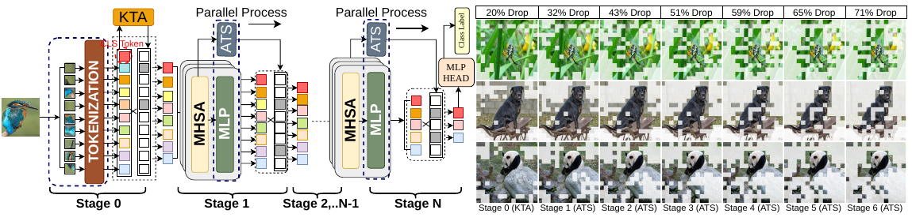

# KTA-Attn ViT — software reproduction

Compact Python implementation and selected software results for **KTA-Attn ViT: A Hierarchical Token Pruning Framework for Accelerating ViTs**, Akshansh Yadav and Palash Das. Includes KTA/ATS inference, FX16 simulation, pruning ablations, attribution visualizations, translation analysis, four notebooks, and figures extracted from the supplied paper. No datasets, weights, archives, duplicate experiment notebooks, or hardware results are included.

**Status:** software runs and plots have been smoke-tested. Full ImageNet accuracy has **not** been independently reproduced. The original evaluation image list and exact pretrained checkpoint are not recorded in the available sources. See [reproduction details](REPRODUCIBILITY.md).



## Setup

Use Python **3.10** (the tested environment), a C++ compiler, and Ninja for QPyTorch's FX16 extension. A CUDA GPU is recommended for full evaluation; CPU smoke runs work.

```bash
python3.10 -m venv .venv
source .venv/bin/activate
pip install -e '.[notebook,test]'
```

The package versions are pinned to the inspected environment. No clean-environment installation or GPU execution has been verified. The first pretrained run downloads timm weights; use `--checkpoint /path/to/state_dict.pth` for a local checkpoint.

## Regenerate result plots immediately

```bash
python scripts/plot_results.py
```

This reads small CSVs and writes `figures/generated/`. It requires only NumPy, pandas, and Matplotlib; it does not run inference. `notebooks/01_results.ipynb` provides the same workflow interactively. CSV names beginning `paper_` contain reported values transcribed from the PDF, not new measurements.

## Evaluate your images

Supply ImageNet validation images as `val/<synset>/<image>.JPEG`, plus the standard class-index JSON mapping output index to `[synset, class_name]`. Dataset images and labels must be obtained separately.

```bash
python scripts/evaluate.py \
  --data /path/to/imagenet/val \
  --labels /path/to/imagenet_class_index.json \
  --model base --kta-drop 0.15 --ats-drop 0.05 \
  --max-images 100 --output runs/smoke.json
```

Remove `--max-images` for all available images. Use `--manifest /path/to/image_paths.txt` to select an explicit ordered subset; paths are relative to `--data`. Each run records its configuration, package versions, checkpoint identity, evaluated image manifest, top-1 accuracy, and mean tokens entering each encoder block. The bundled final logs used 10,000 images; using another subset is a different experiment.

Defaults reproduce the available notebooks' algorithm: FX16 (`FixedPoint(16,8)`), KTA before the encoder, and ATS after blocks **3–8, zero-based**. `--precision fp32` disables quantization. `--kta-drop 0 --ats-drop 0` selects the baseline. `--blocks` with no values disables ATS. Batch size is one because retained token counts depend on each image.

`notebooks/02_evaluate.ipynb` exposes the same configuration. The shared Colab URL could not be retrieved, so these notebooks were built from local sources rather than the linked Colab.

## Highlight result: 1.85-point drop / 49.91% savings

Open [ViT-Base result and evaluation notebook](notebooks/03_vit_base_1_85_drop_49_91_savings.ipynb) for the historical **81.50% accuracy**, **83.35% baseline**, and paper-reported **8.80 GOPs / 49.91% savings**. It includes displayed results, comparison plots, and an optional full evaluation command. The [original experiment notebook](notebooks/04_original_vit_base_30_12.ipynb) contains the full historical implementation and its saved final output. Configuration: **30% KTA**, **12% ATS**, blocks **3–8**, FX16. Source hashes and the final log record are in `results/vit_base_30_12.json`.

## Paper experiments

```bash
# Table IV: tiny/small/base, all 11 reported pruning configurations
python scripts/sweep.py --experiment table-iv \
  --data /path/to/imagenet/val --labels /path/to/imagenet_class_index.json

# Figure 6: 50% KTA or ATS pruning at each encoder location
python scripts/sweep.py --experiment locations --output runs/locations \
  --data /path/to/imagenet/val --labels /path/to/imagenet_class_index.json

# Figure 6/7-style graphs from your actual evaluation results
python scripts/plot_runs.py runs/locations --output runs/location_plots
python scripts/plot_runs.py runs/sweep --output runs/token_plots

# Table VI's proposed-method configuration
python scripts/evaluate.py --data /path/to/imagenet/val \
  --labels /path/to/imagenet_class_index.json --kta-drop .30 --ats-drop .12 \
  --output runs/table_vi.json
```

Table III plots are regenerated from its reported data. The exact pruning-ratio search used to match each method to a computational budget is absent from the provided notebooks; the repository does not invent those settings. Computational costs in the paper tables are reported values, not fresh profiler measurements.

## Attribution and translation

```bash
python scripts/visualize.py /path/to/image.jpg --output runs/visualization

MPLBACKEND=Agg python scripts/center_bias.py \
  --data /path/to/imagenet/val --max-images 1000 --output runs/center_bias
MPLBACKEND=Agg python scripts/translation.py \
  --data /path/to/imagenet/val --max-images 1000 --output runs/translation
```

`visualize.py` creates gradient×token and negative-Kendall-score overlays, plus progressive KTA/ATS masks. It uses FP32 and the evaluation preprocessing consistently; it is not an exact reconstruction of the normalized-input gradient notebook's styling. Original paper artwork is preserved separately. Revision analyses default to FX16 ViT-Base with 50% KTA retention, as in their source notebook; random baselines use an explicit seed.

## Included figures and data

- `figures/paper/`: original software Figures **1, 2, 3, 6, 7**, cropped from the provided PDF. Architecture diagrams are source artwork, not generated experiment plots.
- `figures/generated/`: plots from software Tables III/IV and the revision summaries.
- `results/`: software Tables II/III/IV/VI, 30 selected complete notebook log summaries with hashes, and two small revision summary CSVs.
- `src/kta_attn/`: shared model, Kendall scoring, quantization, and preprocessing.
- `scripts/`: evaluation, sweeps, plotting, visualization, and revision analyses.

To re-extract figures, install Poppler and run:

```bash
python scripts/extract_paper_figures.py /path/to/paper.pdf
```

The PDF itself is excluded to keep the repository small. `figures/paper/provenance.json` records its SHA-256 and exact crop coordinates. Figures retain their original authorship; no new license for the paper artwork is asserted here.

## Validation

```bash
python -m unittest discover -s tests -v
```

Validation covers Kendall score equivalence, ties, retention boundaries, and model inference. Additional CPU smoke runs exercised FX16 evaluation, attribution, center-bias analysis, and all seven translation settings using random weights and one synthetic image. Those smoke outputs are excluded from the repository.
